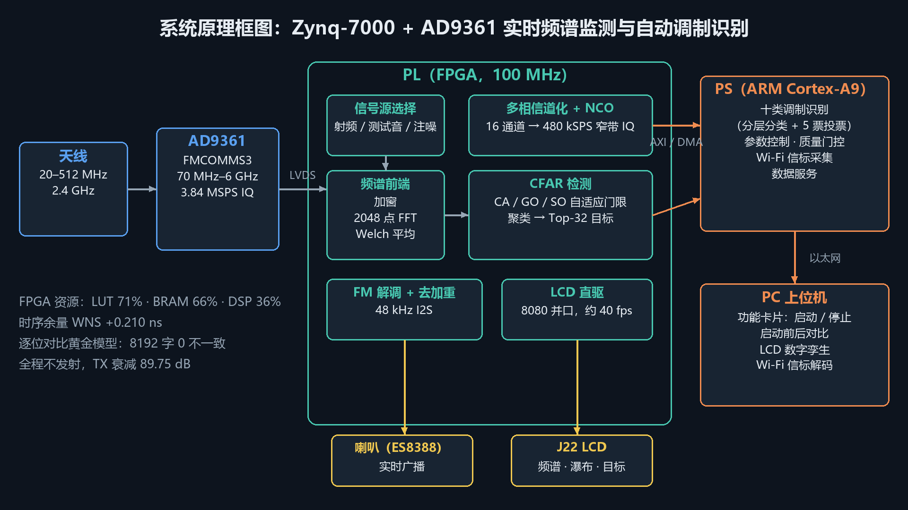

# 频谱哨兵智能监测终端

**Spectrum Sentinel** · 基于 Zynq-7000 与 AD9361 的实时频谱智能监测与自动调制识别终端。

> Zynq-7000 + AD9361 的实时频谱监测、CFAR 检测与自动调制识别终端。
> 参赛作品：全国大学生嵌入式芯片与系统设计竞赛'2026 · FPGA 创新设计赛道 · 自主选题（初级组）

FPGA（PL）承担全部实时信号处理，从接收一直做到显示；ARM（PS）负责调制识别、参数控制与对外服务；PC 上位机负责可视化控制、启动前后对比与 Wi-Fi 信标解码。



## 主要功能

| 层 | 功能 | 状态 |
|---|---|---|
| RF | AD9361（FMCOMMS3）接收，70 MHz–6 GHz，3.84 MSPS IQ，LVDS 接口 | ✅ 上板 |
| PL | 加窗 → 2048 点 FFT → 功率 → Welch 平均；单音 0 bin 误差 | ✅ 上板，逐位对比黄金模型 |
| PL | CFAR 恒虚警检测（CA/GO/SO）、聚类、Top-32 目标 | ✅ 上板，FM 检出率 73.6%（目标 80%） |
| PL | 16 通道多相信道化 + NCO 提取，480 kSPS 窄带 IQ | ✅ 上板 |
| PL | FM 解调 + 去加重 + 48 kHz I2S → ES8388 → 板载喇叭 | ✅ 上板，300 s 零下溢 |
| PL | LCD 8080 直驱（SSD1963，800×480），频谱、瀑布、UI 叠加 | ✅ 约 40 fps（识别模式 29 fps） |
| PS | 十类自动调制识别（分层分类 + 5 票投票） | ⚠️ 仿真 87.65%，空口 10 类 83.4%、8 大类 86.0% |
| PS | FM 质量门控、自动选台、FM 频段搜台 | ✅ 上板 |
| PS | 快速全景扫描（70–512 MHz 现场，可扩展到 2.7 GHz） | ⚠️ 78.4 → 42.2 s，无覆盖缺口 |
| PS | Wi-Fi 信标采集（AD9361 2.4 GHz）+ PC 端解码 | ✅ 上板，仅 FCS 通过的 SSID |
| 上位机 | 功能卡片一键启动/停止、启动前后对比、LCD 数字孪生 | ✅ 上板 |
| 资源 | 100 MHz 时序收敛，LUT 71%、BRAM 66%、DSP 36%，WNS +0.210 ns | ✅ |

未达标项的实测值、原因与改进方向见各阶段验收说明（`docs/*_acceptance_summary.md`）、[上位机功能说明](docs/j7_features.md) 与 [runbook/STATUS.md](runbook/STATUS.md)。

## 仓库结构

```
src/rtl/        Verilog 源码（频谱、CFAR、信道化、NCO、音频、LCD、控制寄存器）
src/hls/        HLS 工程
src/ps/         PYNQ 板端 Python 包 sentinel/、AMC 模型与推理
src/hw/         ADI HDL 工程覆盖层（fmcomms2_z20、sentinel_*）
src/regs/       寄存器定义
board/          板端脚本、位流 overlay（含冻结的 sentinel_v2_100m）、测量证据
tools/          PC 工具：上位机 SentinelHost、黄金模型、板端检查与发布脚本
sim/            RTL testbench、黄金模型与仿真结果
data/           reference 参考数据、captured 录波
docs/           硬件 BOM、板卡信息、工具链、各阶段设计说明
report/         设计方案、验收报告、讲解稿、图表
runbook/        执行手册与阶段状态（开发过程记录）
```

## 快速开始

### 0. 获取源码

```bash
git clone --recurse-submodules https://github.com/Amylaceu/zynq-spectrum-sentinel.git
cd zynq-spectrum-sentinel
```

如果已经克隆但未获取第三方依赖，执行 `git submodule update --init --recursive`。
Windows 上构建 FPGA 工程时，请将仓库放在不含空格和中文的短路径中，例如 `D:\zs`。
正点原子资料及 PYNQ 系统镜像不随仓库分发，需自行取得；发布范围见 [开源发布说明](docs/OPEN_SOURCE_RELEASE.md)。

### 1. 硬件

| 项目 | 值 |
|---|---|
| 开发板 | 正点原子 Z20（xc7z020clg484-2，1 GB DDR3） |
| 射频 | AD-FMCOMMS3-EBZ（AD9361），FMC-LPC J31 |
| 显示 | ATK-MD0700 V2.4（SSD1963，800×480，8080 并口），接 J22 |
| 音频 | ES8388，喇叭 J36（ROUT2 0 dB），P1 LINE_OUT 限 −6 dB |

**上电前必须确认**：J7、J8 均为 **2.5 V**（FMC HR Bank）；插拔子板前完全断电；**没有衰减器时禁止用 SMA 线直连 TX→RX**。

### 2. 板端

```bash
ssh xilinx@<board-ip>            # 默认 PYNQ 镜像 ATK-Z20-2.7.0
sudo sh ~/start_demo.sh          # 进入常驻服务模式
```

位流 `board/overlay/sentinel_v2_100m/sentinel_v2_100m.bit` 为冻结版本，勿替换。

### 3. 上位机

```bash
python -m venv .venv && . .venv/bin/activate      # Windows: .venv\Scripts\activate
pip install -r requirements.txt
python tools/host/product.py --connect <board-ip>
```

### 4. 复现验证

```bash
python -m pytest src/ps/tests tools/host/tests -q     # 板端与上位机测试
python tools/golden_compare.py                        # 黄金模型逐位比对
```

## 第三方依赖

| 依赖 | 版本 | 授权 |
|---|---|---|
| [analogdevicesinc/hdl](https://github.com/analogdevicesinc/hdl) | `hdl_2026_r1`，提交见 `third_party/README.md` | 按各模块许可证，包含 ADI BSD / GPL 等 |
| [analogdevicesinc/no-OS](https://github.com/analogdevicesinc/no-OS) | 提交见 `third_party/README.md` | 按各文件许可证；本项目派生驱动为 BSD-3-Clause |
| AMD Vivado / Vitis | 2025.2 | AMD 许可 |
| PYNQ | 2.7.0 | BSD-3-Clause |

`src/ps/libad9361_pynq/` 派生自 ADI no-OS，保留原文件头，按 BSD-3-Clause 授权；本项目自有代码按 MIT 授权。第三方声明及位流使用范围见 [THIRD_PARTY_NOTICES.md](THIRD_PARTY_NOTICES.md)。

## 授权与安全说明

- 本项目自有代码按 [MIT](LICENSE) 开源；第三方依赖、派生文件与包含第三方模块的位流适用各自的许可条件。
- 设备默认 **不发射**：AD9361 初始化后 TX 衰减固定 89.75 dB。任何空口发射仅限 ISM 频段，并需人工确认。
- 请勿用本项目接收非授权频段以外的内容，或用于干扰他人通信。

## 致谢

- Analog Devices：AD9361 驱动、no-OS 与 HDL 参考设计
- 正点原子：Z20 开发板资料与 PYNQ 镜像（`vendor/atk/`，不随仓库分发）
